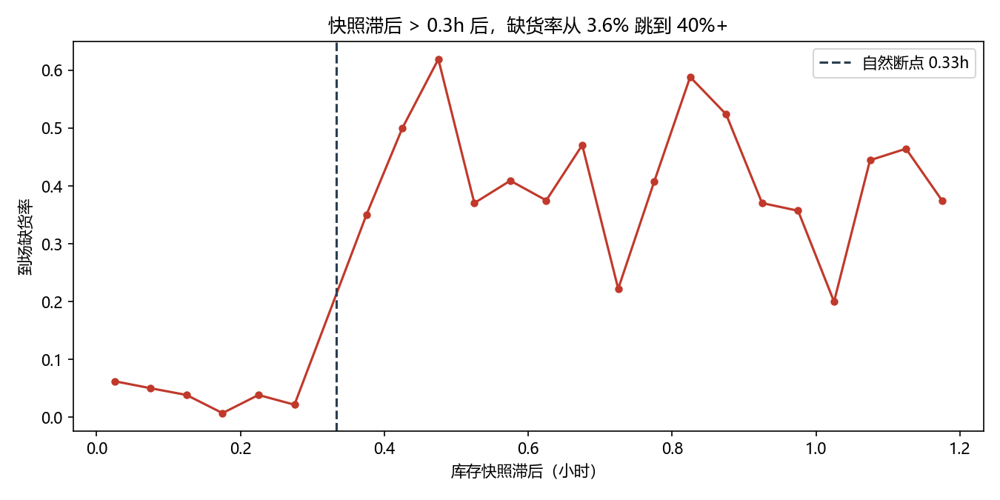
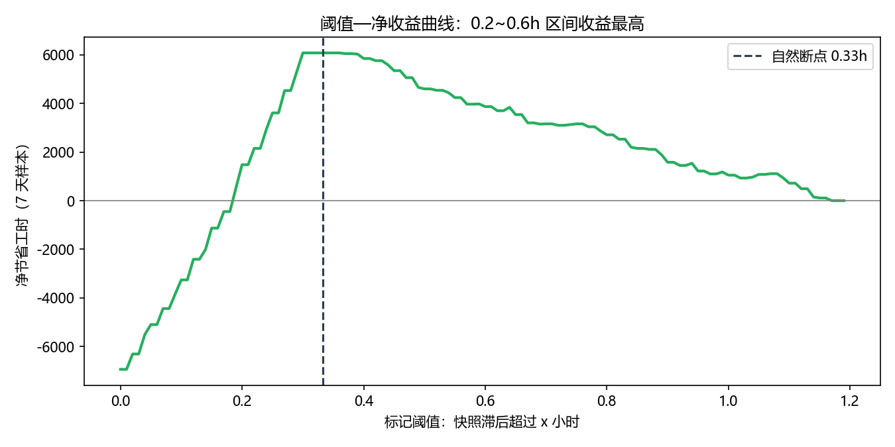
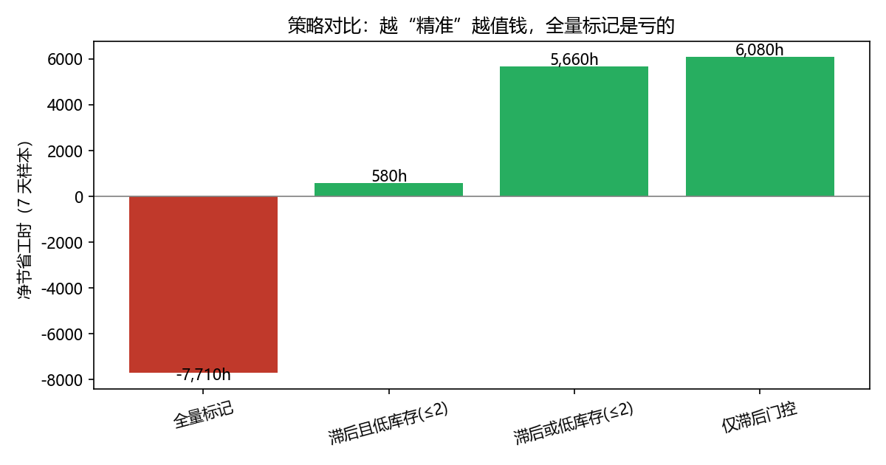

# 备件调配跑空分析

数据：`part_dispatches.csv`（1,270 行，2026-08-31 至 2026-09-07，5 个大区、10 类设备）。
本文所有数字均由该文件通过 `analysis.py` 算出，**未补造任何数据**。

## 我的判断

### 看到了什么

1. **数据本身有坑，先清干净再算**
   - 1,270 行里有 **60 行完全重复**（`dispatch_id` 也重复），去重后为 1,210 张工单。
   - `dispatch_time` 是 `+08:00`，`stock_synced_at` 是 `Z`（UTC）。直接相减会凭空多出 8 小时，必须先统一到 UTC 再算快照滞后。
   - 42 条（3.5%）`fulfilled` 为空（未回传），不纳入效果评估，但单独指出：**反馈闭环缺失本身就是问题**。

2. **主因是库存快照太旧，不是库存少**
   - 按“快照滞后小时数”分桶后，数据在 **0.30h 与 0.37h 之间存在一个空档**（没有任何工单落在这段区间）。以空档中点 **0.33h（约 20 分钟）** 为界：
     - 快照新（≤0.33h）：829 条，缺货率 **3.7%**
     - 快照旧（>0.33h）：344 条，缺货率 **41.9%**，是前者的 **11.3 倍**
   - 344 条旧快照工单只占可评估量的 29%，却贡献了 **144/175 = 82.3%** 的缺货。
   - 低库存、当日报修量、区域、设备品类与缺货有关，但都解释不了这种量级差异。**根问题是：系统允许工程师用一张可能已经过期的库存快照直接发起调配，且没有任何新鲜度校验。**

3. **全量标记是亏钱的，必须精准标记**
   - 题给口径：跑空一次损失 90 工时，提前标记一次花 20 工时。标记的盈亏平衡精确率是 `20/90 = 22.2%`。
   - 对全部工单标记：避免 175×90=15,750h，但标记成本 1,173×20=23,460h，**净亏 7,710h**。
   - 只对旧快照标记：精确率 41.9%，**净省 6,080h**（占基线损失 15,750h 的 **38.6%**）。

**一句话结论：不用建复杂模型，一道“快照超过 20 分钟就先刷新/再标记”的门控，就能在这个样本上拿回约 4 成跑空损失。**

## 做了什么

1. 去重（60 行完全重复）并统一时区，构造 `staleness_h = dispatch_time(UTC) - stock_synced_at(UTC)`。
2. 用滞后分桶的最大空档（0.30h→0.37h）确定 **0.33h** 阈值，而不是拍脑袋取整。
3. 按题给成本口径（90h / 20h）计算每个策略的净节省：`净节省 = 90 × 命中缺货数 − 20 × 标记数`。
4. 做**时序外推验证**：9/1–9/5 训练确定阈值，9/6–9/7 测试，避免“用未来验证过去”。
5. 训练逻辑回归（滞后、库存、报修量、区域、设备）做对照，看简单规则是否够用。
6. 产出 3 张图，脚本一键复现全部数字。

## 怎么证明有用

### 策略对比（1,173 条可评估工单，7 天样本）

| 策略 | 标记数 | 命中缺货 | 误报 | 召回率 | 精确率 | 净节省工时 |
|---|---:|---:|---:|---:|---:|---:|
| 什么都不做 | 0 | 0 | 0 | 0% | — | 0（损失 15,750） |
| **仅旧快照门控（>0.33h）** | **344** | **144** | **200** | **82.3%** | **41.9%** | **+6,080** |
| 旧快照 或 低库存(≤2) | 419 | 156 | 263 | 89.1% | 37.2% | +5,660 |
| 旧快照 且 低库存(≤2) | 34 | 14 | 20 | 8.0% | 41.2% | +580 |
| 全量标记 | 1,173 | 175 | 998 | 100% | 14.9% | **−7,710** |

### 时序外推（训练 9/1–9/5，测试 9/6–9/7）

- 测试集 329 条，缺货 42 条，什么都不做损失 3,780h。
- 训练集学到的阈值仍是 **0.33h**；在测试集标记 105 条，命中 38 条，误报 67 条：
  - 召回率 **90.5%**，精确率 **36.2%**（高于 22.2% 盈亏线）
  - **净节省 1,320h，占测试集基线损失的 34.9%**
- 逻辑回归对照：同样成本口径下测试集净节省 **1,070h**，**不如简单规则**，且可解释性差。结论是先用门控，不必上模型。

### 图表







## 复现步骤

```bash
pip install -r requirements.txt
python analysis.py
```

脚本读取同目录的 `part_dispatches.csv`，输出 `results.json` 和 `charts/` 下三张图，控制台打印上表所有数字。固定随机性（逻辑回归无随机采样），结果可重复。

## 局限与没做的

- **样本只有 7 天、5 个大区**，阈值 0.33h 来自本数据的空档；上线后应按周滚动校准，不建议永久写死。
- **90h / 20h 是题给口径**，未做敏感性分析。但盈亏平衡精确率 22.2% 是硬约束，测试集 36.2% 仍有余量。
- **42 条未回传工单未纳入评估**。如果未回传的工单缺货率显著不同，收益数字会变；这也说明“回传闭环”本身要补。
- 数据是观察性数据，不能直接断言因果。建议小范围灰度：对快照超 20 分钟的工单强制刷新或人工确认，用实际跑空率验证。
- 数据没有备件 SKU 和调配数量，无法做 SKU 级库存推算；如果能拿到，模型还有提升空间。

## 落地建议

1. **调配前置门控**：快照滞后 >20 分钟时，禁止直接下发，先强制刷新；刷新失败则标记人工确认（对应 20h 成本）。
2. **只标记旧快照工单**，不要全量标记、也不要仅按低库存一刀切——这两种做法在本数据上净收益更低或是负的。
3. **补齐 `fulfilled` 回传**：3.5% 未回传会让所有后续评估失真。
4. 上线后按周监控“门控命中精确率”，低于 22.2% 就说明阈值失效，需要重新校准。
